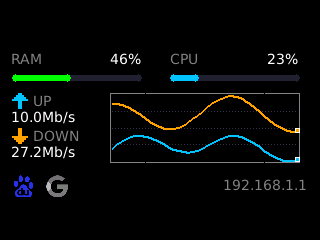

<div align="center">

# xgp_screen


Real-time system dashboard for the XGP v3 GC9307 TFT display.

</div>



## Architecture

```
LuCI Web UI (JS view)
        |
        v (UCI)
Go Daemon (procd)
  collector -> screen -> /dev/fb0 320x240
```

## Features

- RAM/CPU usage bars
- Live up/down throughput chart
- Connectivity icons (Baidu/Google)
- Router LAN IP display
- 1 Hz refresh, auto-start on boot

## Install

```sh
curl -fsSL https://raw.githubusercontent.com/voorz/xgp_screen/main/install.sh | sh
```

## License

See LICENSE file.
